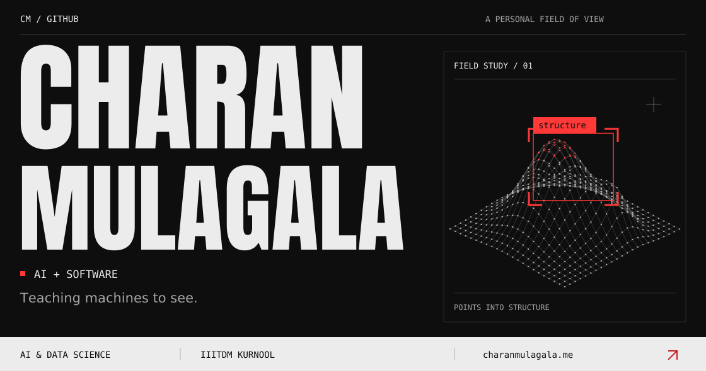
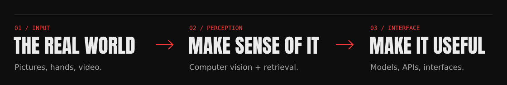

  <a href="https://charanmulagala.me"><strong>Portfolio ↗</strong></a> &nbsp; / &nbsp;
  <a href="https://www.linkedin.com/in/charanmulagala/">LinkedIn ↗</a> &nbsp; / &nbsp;
  <a href="mailto:contact@charanmulagala.me">Say hello ↗</a>

### In focus

I'm Charan, a **B.Tech student in Artificial Intelligence & Data Science at IIITDM Kurnool**, graduating in **2027**. I'm interested in problems that start outside a clean dataset: imperfect images, movement, and long stretches of video.

I like working through the whole path — understanding the input, building the model, and making it usable through an application. Getting it to run on hardware people already own matters to me.

- **Computer vision:** making sense of images and motion with detection, recognition, and visual features.
- **Retrieval & ML:** connecting visual information with useful search and answers.
- **Software around the model:** APIs, interfaces, and the practical work of making everything run together.

### On the workbench

<table>
  <tr><th align="left">Area</th><th align="left">Tools I work with</th></tr>
  <tr><td><strong>Languages</strong></td><td>Python · C++ · C · JavaScript · Go · SQL</td></tr>
  <tr><td><strong>Vision & ML</strong></td><td>PyTorch · TensorFlow · scikit-learn · OpenCV · MediaPipe</td></tr>
  <tr><td><strong>Data & retrieval</strong></td><td>Pandas · Seaborn · CLIP / BLIP · LangChain · FAISS</td></tr>
  <tr><td><strong>Apps & deployment</strong></td><td>FastAPI · Flask · Streamlit · ONNX Runtime · Docker</td></tr>
  <tr><td><strong>Everyday tools</strong></td><td>Git · Linux · VS Code · JupyterLab</td></tr>
</table>

**Currently learning** &nbsp; Swift, alongside AI/ML and full-stack development. 
**Also interested in** &nbsp; Data structures & algorithms, and RISC-V architecture.

### Along the way

**2024–25 · Codexintern** — Python developer internship. Backend tools and automation with Flask and SQL. 
**2025 · ElevateLabs** — AI/ML internship. Data preprocessing, visualisation, and model-building with scikit-learn and TensorFlow. 
**2025 · Salesforce** — Developer internship. Apex, Lightning Web Components, and process automation.

### Outside the frame

Photography is the other way I work with images. I'm part of **Apertura Club** and coordinate photography activities at IIITDM Kurnool — covering campus events and helping run workshops and competitions.

I'm open to **internships and graduate roles in ML and software**. If you're working on something in that space, <a href="mailto:contact@charanmulagala.me">let's talk</a>.

### On GitHub

  
  

 

