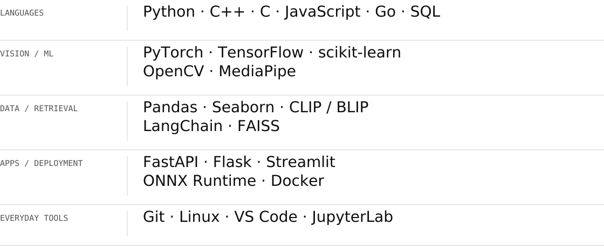
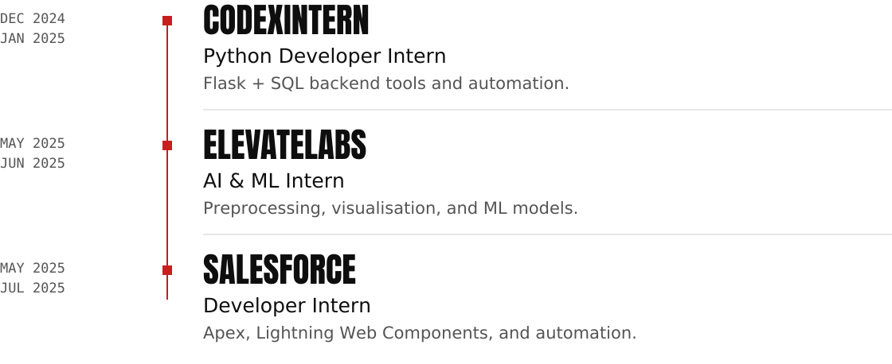

  <a href="https://charanmulagala.me"><strong>Portfolio ↗</strong></a> &nbsp; / &nbsp;
  <a href="https://www.linkedin.com/in/charanmulagala/">LinkedIn ↗</a> &nbsp; / &nbsp;
  <a href="mailto:contact@charanmulagala.me">Say hello ↗</a>

 

<picture>
  <source media="(max-width: 600px) and (prefers-color-scheme: dark)" srcset="assets/middle/focus-mobile-dark.svg">
  <source media="(max-width: 600px)" srcset="assets/middle/focus-mobile-light.svg">
  <source media="(prefers-color-scheme: dark)" srcset="assets/middle/focus-dark.svg">
  
</picture>

I'm Charan, a **B.Tech student in Artificial Intelligence & Data Science at IIITDM Kurnool**, graduating in **2027**. I'm interested in problems that start outside a clean dataset: imperfect images, movement, and long stretches of video.

I like working through the whole path — understanding the input, building the model, and making it usable through an application. Getting it to run on hardware people already own matters to me.

- **Computer vision:** making sense of images and motion with detection, recognition, and visual features.
- **Retrieval & ML:** connecting visual information with useful search and answers.
- **Software around the model:** APIs, interfaces, and the practical work of making everything run together.

 

<picture>
  <source media="(max-width: 600px) and (prefers-color-scheme: dark)" srcset="assets/middle/workbench-mobile-dark.svg">
  <source media="(max-width: 600px)" srcset="assets/middle/workbench-mobile-light.svg">
  <source media="(prefers-color-scheme: dark)" srcset="assets/middle/workbench-dark.svg">
  
</picture>

<picture>
  <source media="(max-width: 600px) and (prefers-color-scheme: dark)" srcset="assets/middle/toolkit-mobile-dark.svg">
  <source media="(max-width: 600px)" srcset="assets/middle/toolkit-mobile-light.svg">
  <source media="(prefers-color-scheme: dark)" srcset="assets/middle/toolkit-dark.svg">
  
</picture>

Toolkit — text version

- **Languages:** Python · C++ · C · JavaScript · Go · SQL
- **Vision & ML:** PyTorch · TensorFlow · scikit-learn · OpenCV · MediaPipe
- **Data & retrieval:** Pandas · Seaborn · CLIP / BLIP · LangChain · FAISS
- **Apps & deployment:** FastAPI · Flask · Streamlit · ONNX Runtime · Docker
- **Everyday tools:** Git · Linux · VS Code · JupyterLab

**Currently learning** &nbsp; Swift, alongside AI/ML and full-stack development. 
**Also interested in** &nbsp; Data structures & algorithms, and RISC-V architecture.

 

<picture>
  <source media="(max-width: 600px) and (prefers-color-scheme: dark)" srcset="assets/middle/experience-mobile-dark.svg">
  <source media="(max-width: 600px)" srcset="assets/middle/experience-mobile-light.svg">
  <source media="(prefers-color-scheme: dark)" srcset="assets/middle/experience-dark.svg">
  
</picture>

<picture>
  <source media="(max-width: 600px) and (prefers-color-scheme: dark)" srcset="assets/middle/timeline-mobile-dark.svg">
  <source media="(max-width: 600px)" srcset="assets/middle/timeline-mobile-light.svg">
  <source media="(prefers-color-scheme: dark)" srcset="assets/middle/timeline-dark.svg">
  
</picture>

Experience — text version

- **Dec 2024–Jan 2025 · Codexintern:** Python Developer Intern. Backend tools and automation with Flask and SQL.
- **May–Jun 2025 · ElevateLabs:** AI & ML Intern. Data preprocessing, visualisation, and model-building with scikit-learn and TensorFlow.
- **May–Jul 2025 · Salesforce:** Developer Intern. Apex, Lightning Web Components, and process automation.

 

<picture>
  <source media="(max-width: 600px) and (prefers-color-scheme: dark)" srcset="assets/middle/outside-mobile-dark.svg">
  <source media="(max-width: 600px)" srcset="assets/middle/outside-mobile-light.svg">
  <source media="(prefers-color-scheme: dark)" srcset="assets/middle/outside-dark.svg">
  
</picture>

Photography is the other way I work with images. I'm part of **Apertura Club** and coordinate photography activities at IIITDM Kurnool — covering campus events and helping run workshops and competitions.

I'm open to **internships and graduate roles in ML and software**. If you're working on something in that space, <a href="mailto:contact@charanmulagala.me">let's talk</a>.

 

<picture>
  <source media="(max-width: 600px) and (prefers-color-scheme: dark)" srcset="assets/middle/github-mobile-dark.svg">
  <source media="(max-width: 600px)" srcset="assets/middle/github-mobile-light.svg">
  <source media="(prefers-color-scheme: dark)" srcset="assets/middle/github-dark.svg">
  
</picture>

  
  

 

